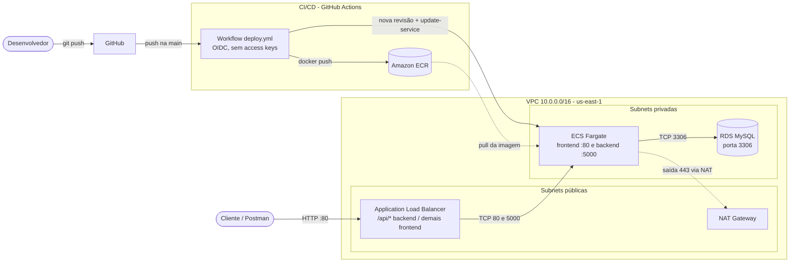
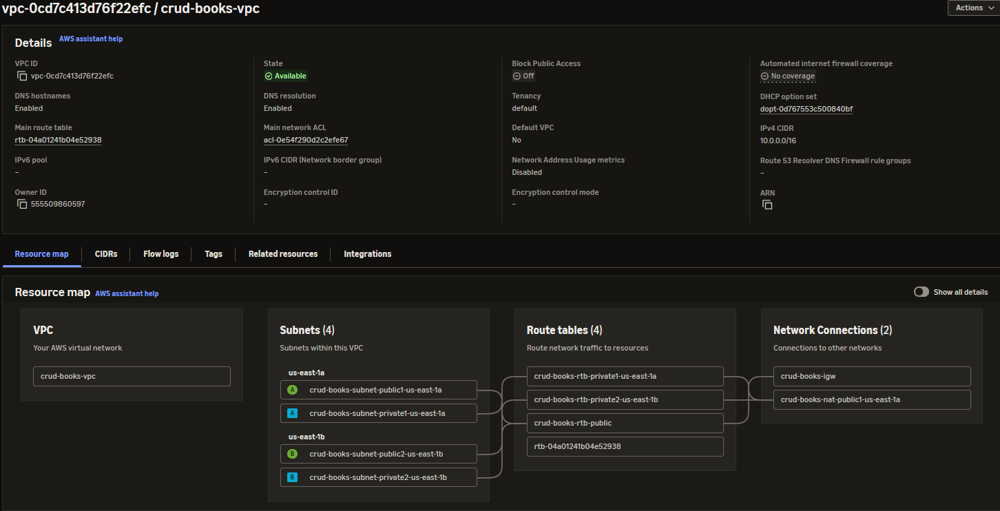
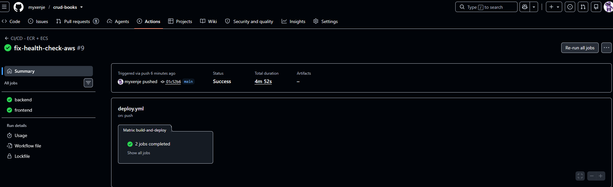
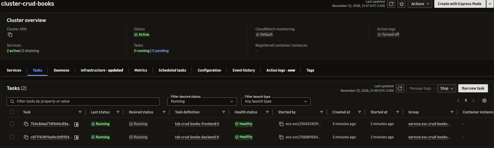

# 📚 CRUD Books — aplicação conteinerizada na AWS

## 📖 Sobre o projeto

Aplicação **full stack** de cadastro de livros (CRUD) com **React**, **Node.js** e **MySQL**, conteinerizada com **Docker** e implantada na **AWS** com **ECS Fargate**, **RDS MySQL**, **ECR** e **Application Load Balancer**. O deploy é automatizado por um pipeline de **CI/CD com GitHub Actions**, autenticado na AWS via **OIDC** (sem access keys armazenadas).

O foco do projeto é a **infraestrutura em nuvem**: rede própria (VPC com subnets públicas e privadas), banco em subnet privada, Security Groups encadeados e IAM com **privilégio mínimo**.


---

## 📋 Visão geral

| Item | Detalhe |
|---|---|
| **Aplicação** | CRUD de livros (listar com paginação, cadastrar, editar e excluir) |
| **Frontend** | React 17 (JavaScript), build estático servido por **Nginx** |
| **Backend** | Node.js + Express, API REST |
| **Banco de dados** | MySQL 8.4 (local) / **Amazon RDS MySQL** (AWS) |
| **Acesso ao banco** | Knex.js (query builder) com migrations |
| **Container** | Docker, build multi-stage no frontend |
| **Orquestração** | Amazon ECS com Fargate (2 services, um para o front e outro para o back) |
| **Entrada de tráfego** | Application Load Balancer único, com roteamento por path |
| **CI/CD** | GitHub Actions → Amazon ECR → Amazon ECS |
| **Região** | `us-east-1` (N. Virginia) |

---

## 🏗 Arquitetura na AWS



> O diagrama completo (com CIDRs, Security Groups, IAM e rotas) está em [`docs/arq-aws-crud-books.drawio`](docs/arq-aws-crud-books.drawio) e pode ser aberto em [app.diagrams.net](https://app.diagrams.net).

### Fluxo de uma requisição

1. O cliente acessa o **Application Load Balancer** (subnets públicas, porta 80).
2. O listener aplica uma regra por path: requisições para **`/api/*`** vão para o target group do **backend** (porta 5000); todas as demais vão para o target group do **frontend** (porta 80).
3. As tasks Fargate rodam em **subnets privadas** e só aceitam tráfego vindo do ALB.
4. O backend consulta o **RDS MySQL** (porta 3306), que só aceita conexões vindas do Security Group do backend.
5. A saída das tasks para a internet (pull de imagem no ECR e envio de logs) passa pelo **NAT Gateway**.

Como o navegador chama a API pelo mesmo domínio do ALB (`/api`), não há necessidade de configurar CORS entre domínios diferentes nem de expor a porta 5000 publicamente.

---

## 🛠 Tecnologias

**Aplicação**
- JavaScript, Node.js e Express
- React 17, React Router e Axios
- Knex.js + driver `mysql2`

**Containerização**
- Docker (backend em `node`, frontend em build multi-stage `node:22-alpine` → `nginx:alpine`)
- Docker Compose (ambiente local com frontend, backend e MySQL)

**AWS**
- **VPC** com subnets públicas e privadas, Internet Gateway e NAT Gateway
- **Application Load Balancer** com dois Target Groups
- **ECS Fargate** (cluster, task definitions e services)
- **ECR** (repositórios das imagens)
- **RDS MySQL** (Single-AZ, em subnet privada)
- **IAM** e **Security Groups** com privilégio mínimo
- **CloudWatch Logs** (logs dos containers)

**CI/CD e ferramentas**
- GitHub Actions com autenticação **OIDC**
- Postman (testes dos endpoints)
- Git / GitHub (branch protegida, pull requests com checks obrigatórios)

---

## 🌐 Rede (VPC)

VPC dedicada `crud-books-vpc` (`10.0.0.0/16`) distribuída em **2 Availability Zones**:

| Subnet | AZ | CIDR | Uso |
|---|---|---|---|
| `crud-books-subnet-public1-us-east-1a` | us-east-1a | `10.0.1.0/24` | ALB, NAT Gateway |
| `crud-books-subnet-public2-us-east-1b` | us-east-1b | `10.0.11.0/24` | ALB |
| `crud-books-subnet-private1-us-east-1a` | us-east-1a | `10.0.2.0/24` | Tasks ECS, RDS |
| `crud-books-subnet-private2-us-east-1b` | us-east-1b | `10.0.22.0/24` | Tasks ECS, RDS (DB Subnet Group) |

**Tabelas de rota**

| Tabela | Rotas |
|---|---|
| Pública (`crud-books-rtb-public`) | `10.0.0.0/16 → local`, `0.0.0.0/0 → Internet Gateway` |
| Privadas (`rtb-private1` e `rtb-private2`) | `10.0.0.0/16 → local`, `0.0.0.0/0 → NAT Gateway` |

O **DB Subnet Group** do RDS usa apenas as subnets privadas, e o banco **não tem acesso público**.



---

## 🔐 Segurança: Security Groups e IAM

### Security Groups (referenciando outros SGs, sem abrir CIDRs desnecessários)

| Security Group | Inbound | Outbound |
|---|---|---|
| `alb-sg` | TCP 80 ← `0.0.0.0/0` | TCP 80 e 5000 → SGs das tasks |
| `ecs-frontend-sg` | TCP 80 ← `alb-sg` | TCP 443 → `0.0.0.0/0` (ECR e Logs via NAT) |
| `ecs-backend-sg` | TCP 5000 ← `alb-sg` | TCP 3306 → `rds-sg` · TCP 443 → `0.0.0.0/0` (ECR e Logs via NAT) |
| `rds-sg` | TCP 3306 ← `ecs-backend-sg` | N/A

- Sem SSH aberto em nenhum recurso.
- O banco só é alcançável a partir das tasks do backend.
- O frontend não tem caminho de rede até o banco.

### IAM (privilégio mínimo)

| Role | Permissões principais |
|---|---|
| `ecs-task-execution-role` | `AmazonECSTaskExecutionRolePolicy` (pull no ECR e logs no CloudWatch) |
| `ecs-task-role` | Somente o que a aplicação usa, sem permissões extras |
| `github-actions-role` | `ecr:GetAuthorizationToken`, push apenas nos dois repositórios do ECR, `ecs:RegisterTaskDefinition`, `ecs:DescribeServices`, `ecs:UpdateService` e `iam:PassRole` restrito às roles da task |

### Autenticação do pipeline via OIDC

O GitHub Actions **não usa access keys**. O workflow assume a role na AWS por **OIDC** (`sts:AssumeRoleWithWebIdentity`), e a *trust policy* da role aceita apenas tokens do **repositório e da branch `main`**:

- `aud` igual a `sts.amazonaws.com`
- `sub` igual ao repositório e à branch `main` (com `StringEquals`, sem curingas)

Assim, um fork, outra branch ou um pull request não conseguem obter credenciais para fazer deploy.

### Segredos

As credenciais do banco **não ficam no código nem na imagem**: são injetadas como variáveis de ambiente na task definition do ECS. Localmente, o arquivo `db.env` fica fora do Git (`.gitignore`).

---

## 🔄 CI/CD

Workflow `CI/CD - ECR + ECS` ([`.github/workflows/deploy.yml`](.github/workflows/deploy.yml)), com uma *matrix* que executa backend e frontend em paralelo.

| Evento | O que acontece |
|---|---|
| **Pull request** para `main` | **CI:** valida que as duas imagens Docker constroem. Não acessa a AWS. |
| **Push / merge** na `main` | **CD:** build, push no ECR e deploy no ECS |
| **Manual** (`workflow_dispatch`) | Executa o mesmo deploy a partir do botão *Run workflow* |

**Etapas do deploy:**

1. **Checkout** do código.
2. **Credenciais AWS** por OIDC.
3. **Login no ECR** e **build** da imagem (`linux/amd64`).
4. **Push** da imagem com a tag do **SHA do commit**.
5. **Baixa a task definition** em uso pelo service, preservando variáveis de ambiente e configurações.
6. **Define o health check do container** na task definition.
7. **Atualiza a imagem** no container.
8. **Deploy no ECS** (rolling update) e espera o service estabilizar (`wait-for-service-stability`).

**Versionamento das imagens:** cada imagem é tagueada com o **SHA do commit**, o que garante rastreabilidade entre o código e o que está rodando, e facilita o rollback para uma revision anterior da task definition.

**Proteção da branch `main`:** exige pull request e os checks `backend` e `frontend` verdes antes do merge. Como o merge é o que dispara o deploy, código que não builda não chega à AWS.



---

## ☁️ Execução no ECS Fargate

| Recurso | Nome |
|---|---|
| Cluster | `cluster-crud-books` |
| Services | `svc-crud-books-frontend` e `svc-crud-books-backend` (Replica, Fargate) |
| Task definitions | `tsk-crud-books-frontend` e `tsk-crud-books-backend` |
| Repositórios ECR | `crud-books-frontend` e `crud-books-backend` |
| Load Balancer | `alb-crud-books` (listener HTTP:80) |
| Target Groups | `tg-crud-books` (frontend, HTTP 80) e `tg-crud-books-backend` (backend, HTTP 5000) |
| Banco | RDS MySQL, Single-AZ, sem acesso público |

**Health checks em duas camadas**

- **ALB:** os dois target groups verificam `GET /health` e esperam `200`. O endpoint do backend não consulta o banco, para que uma lentidão do RDS não derrube todas as tasks. No frontend, o Nginx responde `/health` diretamente.
- **Container:** a task definition também define um health check interno (`curl` no backend, `wget` no frontend), que mantém o status das tasks em **Healthy** no ECS.

Ao iniciar, o container do backend executa as **migrations** (`knex migrate:latest`) e só então sobe a API.



---

## ✨ Funcionalidades

- Listagem de livros com **paginação** (botão "Carregar mais livros")
- Cadastro de livro (título, autor, preço e data de lançamento)
- Edição de livro
- Exclusão com confirmação
- Contador de livros exibidos e estado vazio quando não há registros
- Formatação de preço em **BRL** e de data no padrão `pt-BR`

---

## 📡 Endpoints da API

Base path: `/api` (o health check fica fora do prefixo)

| Método | Rota | Descrição | Resposta |
|---|---|---|---|
| `GET` | `/health` | Verificação de saúde | `200` |
| `GET` | `/api/book?page=1` | Lista livros paginados (2 por página) | `200` `{ total, books }` |
| `GET` | `/api/book/:id` | Busca livro por ID | `200` |
| `POST` | `/api/book` | Cadastra um livro | `200` com o livro criado |
| `PUT` | `/api/book` | Atualiza um livro (o `id` vai no corpo) | `200` com o livro atualizado |
| `DELETE` | `/api/book/:id` | Remove o livro | `204` |

### Modelo do livro

| Campo | Tipo | Regras |
|---|---|---|
| `id` | inteiro | Auto incremento |
| `title` | string | Obrigatório |
| `author` | string | Obrigatório |
| `price` | decimal(8,2) | Obrigatório |
| `launchDate` | datetime | Padrão: data/hora atual |

### Exemplos

```bash
# Listar livros
curl "http://<ALB_DNS>/api/book?page=1"

# Cadastrar
curl -X POST http://<ALB_DNS>/api/book \
  -H "Content-Type: application/json" \
  -d '{"title": "The Bonzi Books", "author": "Michel Cardoso", "price": 77, "launchDate": "2026-11-20"}'

# Atualizar
curl -X PUT http://<ALB_DNS>/api/book \
  -H "Content-Type: application/json" \
  -d '{"id": 1, "title": "The Bonzi Books", "author": "Michel Cardoso", "price": 77, "launchDate": "2026-11-20"}'

# Remover
curl -X DELETE http://<ALB_DNS>/api/book/1
```

Os endpoints também foram testados com o **Postman**.

---

## 💻 Executando localmente

**Pré-requisitos:** Docker e Docker Compose.

```bash
# 1. Clonar o repositório
git clone https://github.com/myxenje/crud-books.git
cd crud-books

# 2. Criar o arquivo de ambiente do banco a partir do exemplo
cp db.env.example db.env
```

Edite o `db.env` com estes valores (são os padrões que o backend usa no ambiente local):

```env
TZ=America/Sao_Paulo
MYSQL_DATABASE=crudbook_db
MYSQL_USER=docker
MYSQL_PASSWORD=docker12345
MYSQL_ROOT_PASSWORD=root12345
```

```bash
# 3. Subir frontend, backend e MySQL
docker compose up -d --build
```

| Serviço | URL |
|---|---|
| Frontend | http://localhost |
| API | http://localhost:5000/api/book |
| Health do backend | http://localhost:5000/health |
| MySQL (host) | `localhost:3308` |

No Compose, o frontend é construído com `REACT_APP_API_URL=http://localhost:5000/api`. Na AWS, o valor padrão é `/api`, resolvido pelo mesmo domínio do ALB. As migrations rodam automaticamente na subida do backend e criam a tabela `book` com alguns livros de exemplo.

### Variáveis de ambiente do backend

| Variável | Padrão | Descrição |
|---|---|---|
| `DB_HOST` | `db` | Host do banco (`db` no Compose / endpoint do RDS na AWS) |
| `DB_PORT` | `3306` | Porta do MySQL |
| `DB_NAME` | `crudbook_db` | Nome do banco |
| `DB_USER` | `docker` | Usuário |
| `DB_PASSWORD` | `docker123` | Senha |
| `PORT` | `5000` | Porta da API |

Na AWS, esses valores são definidos na task definition do ECS.

---

## 📂 Estrutura do projeto

```text
crud-books/
├── .github/
│   └── workflows/
│       └── deploy.yml            # CI/CD: build, push no ECR e deploy no ECS
├── backend/
│   ├── src/
│   │   ├── controllers/          # lógica das rotas
│   │   ├── database/
│   │   │   ├── migrations/       # criação da tabela book e dados de exemplo
│   │   │   └── connection.js     # instância do Knex
│   │   ├── routes.js
│   │   └── index.js              # API Express e /health
│   ├── knexfile.js               # conexão com o banco via variáveis de ambiente
│   ├── startup.sh                # roda as migrations e inicia a API
│   ├── wait-for.sh               # aguarda o MySQL (uso local)
│   └── Dockerfile
├── frontend/
│   ├── src/
│   │   ├── pages/                # Books e NewBook
│   │   ├── services/api.js       # cliente Axios
│   │   └── routes.js
│   ├── nginx.conf                # serve o build e responde /health
│   └── Dockerfile                # multi-stage: build com Node, serve com Nginx
├── docs/
│   ├── arq-crud-books.drawio     # diagrama da arquitetura
│   └── images/                   # prints da AWS e do pipeline
├── docker-compose.yaml           # ambiente local
├── db.env.example
└── .gitattributes                # mantém os scripts .sh com quebra de linha LF
```

---

## 🧩  aprendizados

- Automatizar deploy no ECS com GitHub Actions e OIDC, sem credenciais de longa duração.
- Investigar falhas de ponta a ponta com logs do GitHub Actions, eventos do ECS, task parada e CloudTrail.
- Proteger a branch principal para que o deploy só aconteça após o CI passar.

---

## 👨‍💻 Autor

Michel Cardoso

Projeto desenvolvido para fins de estudo e prática de tecnologias voltadas para desenvolvimento back-end, infraestrutura, aws cloud e containerização.